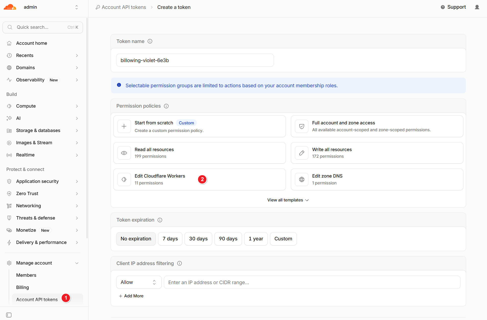
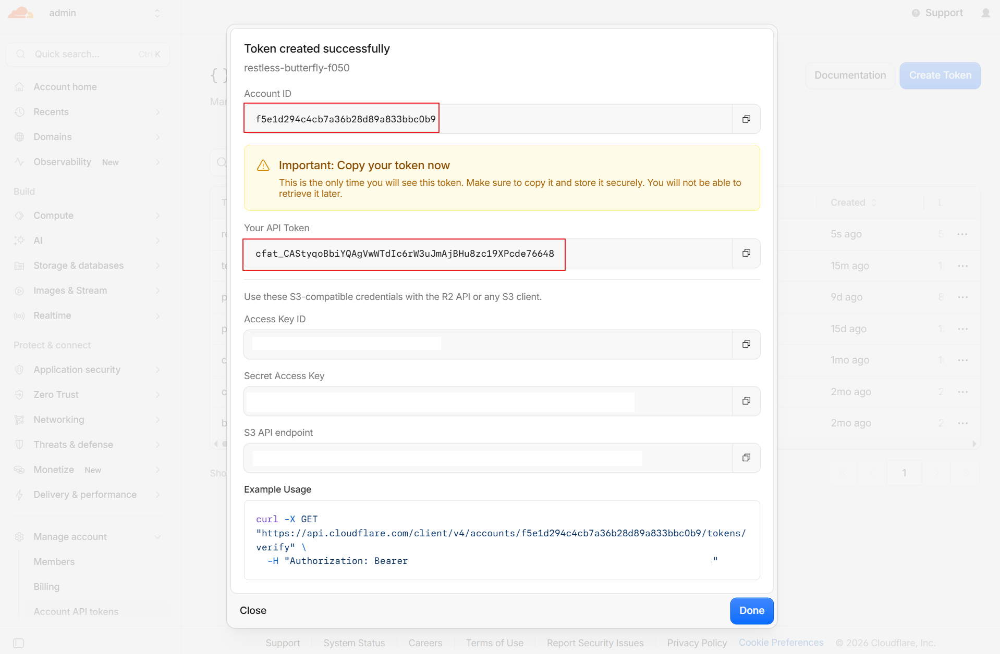
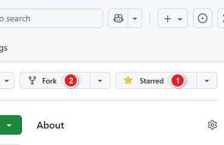
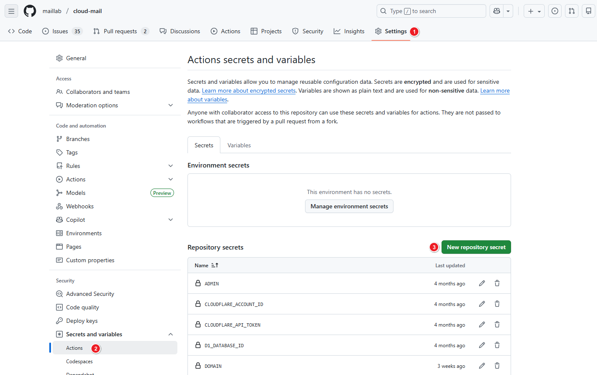
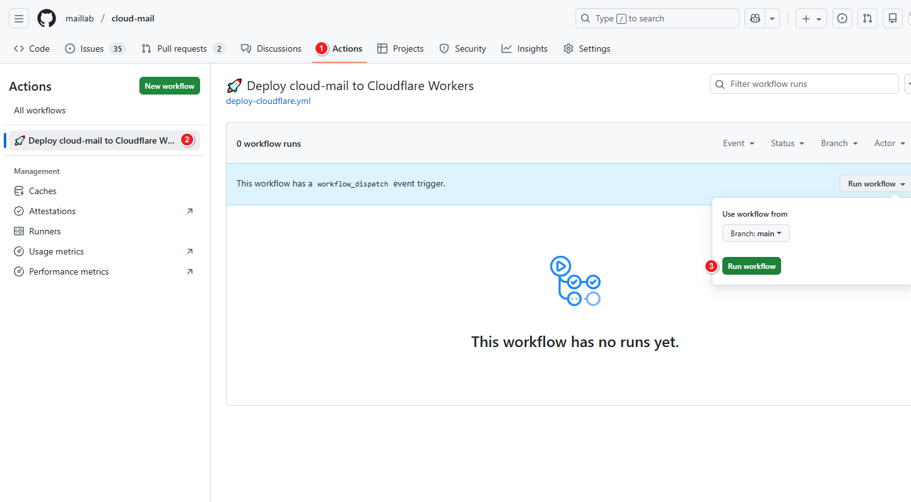
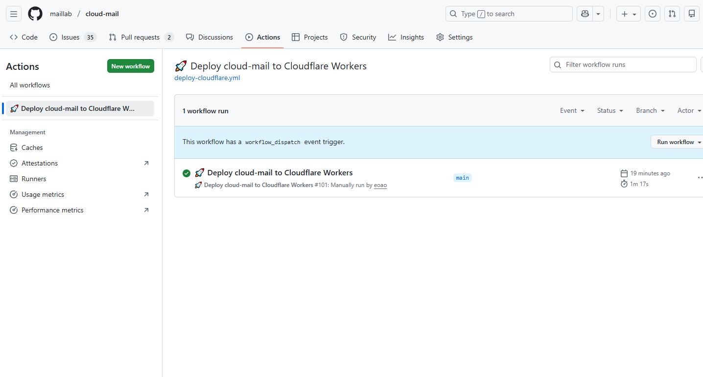
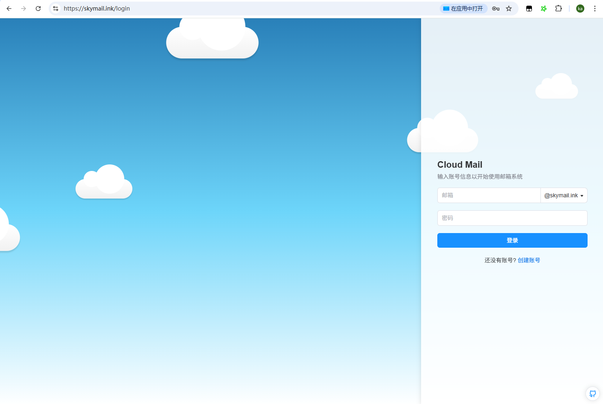

# GitHub Actions Deployment

## Create an API Token

1. [Create an API token](https://dash.cloudflare.com/profile/api-tokens) using the Workers template.
   

2. Copy your account ID and API token.
   

## Environment Setup

1. Fork the repository: [https://github.com/maillab/cloud-mail](https://github.com/maillab/cloud-mail)
   

2. Add the following GitHub Actions secrets or variables.

| Variable Name         | Required | Description                                                                                     |
|-----------------------|:--------:|-------------------------------------------------------------------------------------------------|
| CLOUDFLARE_API_TOKEN  |    ✅     | Cloudflare API token                                                                            |
| CLOUDFLARE_ACCOUNT_ID |    ✅     | Cloudflare account ID                                                                           |
| CUSTOM_DOMAIN         |    ✅     | Custom domain used to access the website, e.g., `skymail.ink`                                   |
| DOMAIN                |    ✅     | Email domains, e.g., `["example.com", "example2.com"]`                                          |
| ADMIN                 |    ✅     | Administrator email address, e.g., `admin@example.com`                                          |
| D1_DATABASE_ID        |    ✅     | D1 database ID. See [Dashboard - Bind Databases](/en/deployment/dashboard.html#bind-databases). |
| KV_NAMESPACE_ID       |    ✅     | KV namespace ID. See [Dashboard - Bind Databases](/en/deployment/dashboard.html#bind-databases).              |
| JWT_SECRET            |    ✅     | JWT secret key. Enter a random string without special characters.                               |
| NAME                  |    ❌     | Worker project name. Defaults to `cloud-mail`.                                                  |

## Deployment

1. Run the GitHub Actions workflow.
   

2. Wait for the workflow to complete.
   

## Configure Email Forwarding

1. Follow the [Configure Email Forwarding](dashboard.html#configure-email-forwarding) steps in the Dashboard deployment guide.

2. Open your custom domain in a browser, register an administrator account, and log in.
   

**Deployment complete!**

