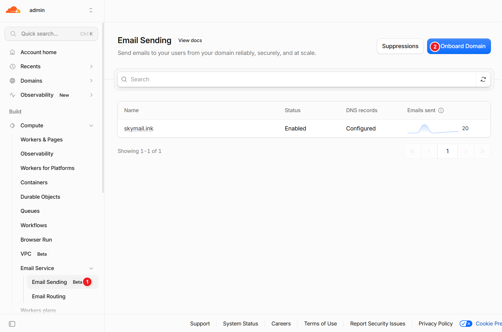
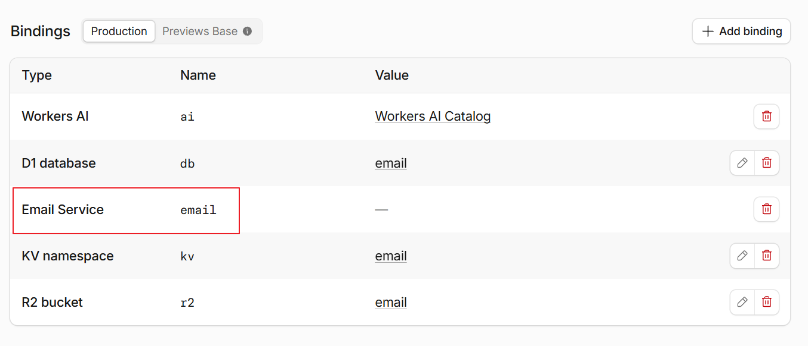
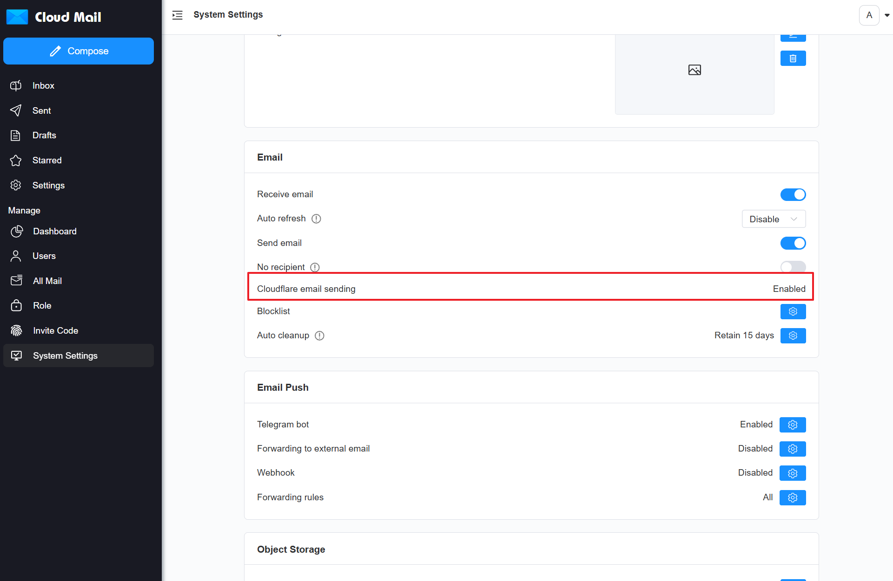

# Cloudflare Email Sending
:::warning
Sending email this way requires Workers Paid.
:::

1. Add the domain used to send email.
   

2. Bind the email service to an Action Secret or a Workers binding. The variable value is fixed as `email`.

   | Worker Binding Name | Action Secret | Required | Description        |
   |---------------------|---------------|:--------:|--------------------|
   | email               | EMAIL         |    ✅    | Always enter `email` |

   

3. Cloudflare Email will be enabled in System Settings.
   
