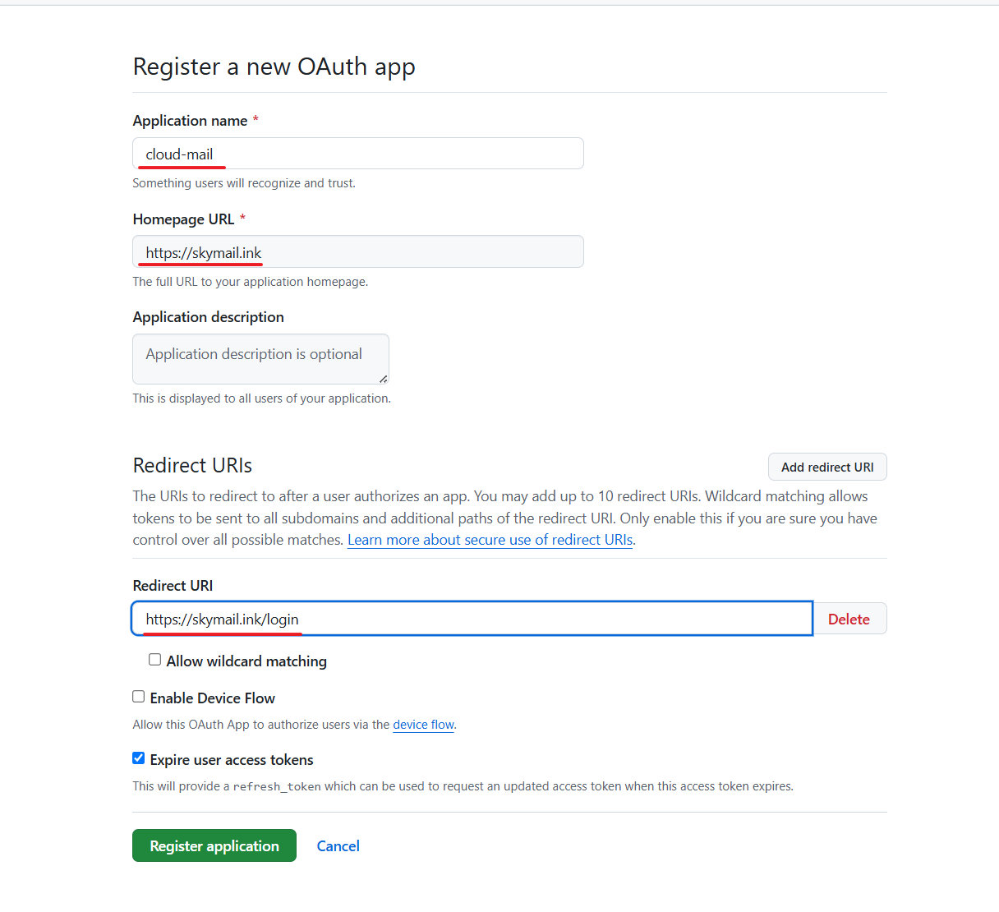
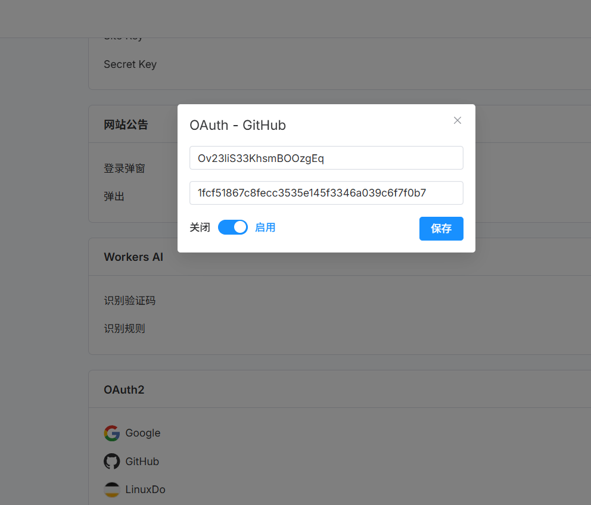

# OAuth2 Login

## Using GitHub

1. [Create an OAuth app on GitHub](https://github.com/settings/applications/new).

2. Set the callback URL to `https://your-worker-custom-domain/login`, replacing `your-worker-custom-domain` with your Worker's custom domain.

   

3. Generate a client secret, then add your OAuth app credentials in System Settings.

   
