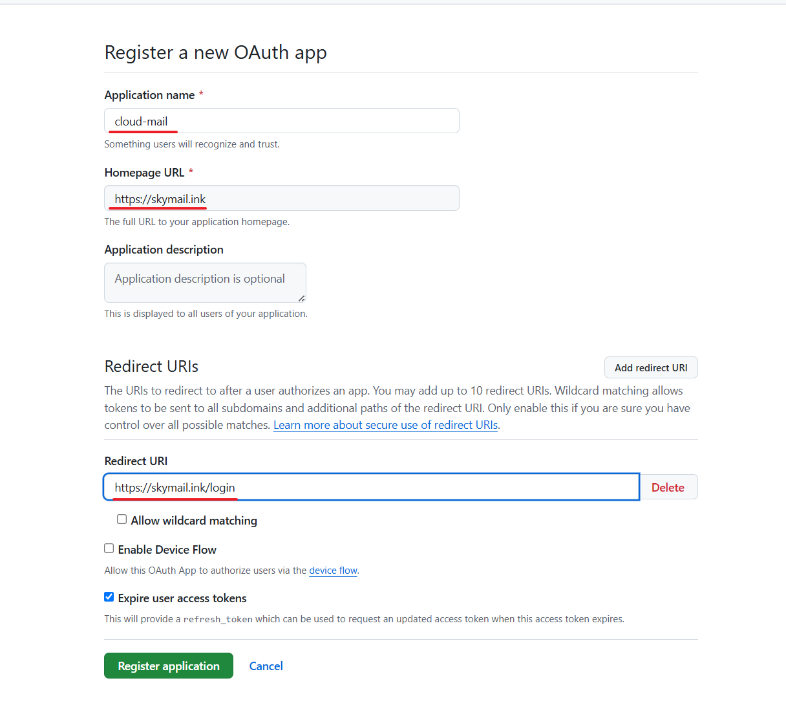
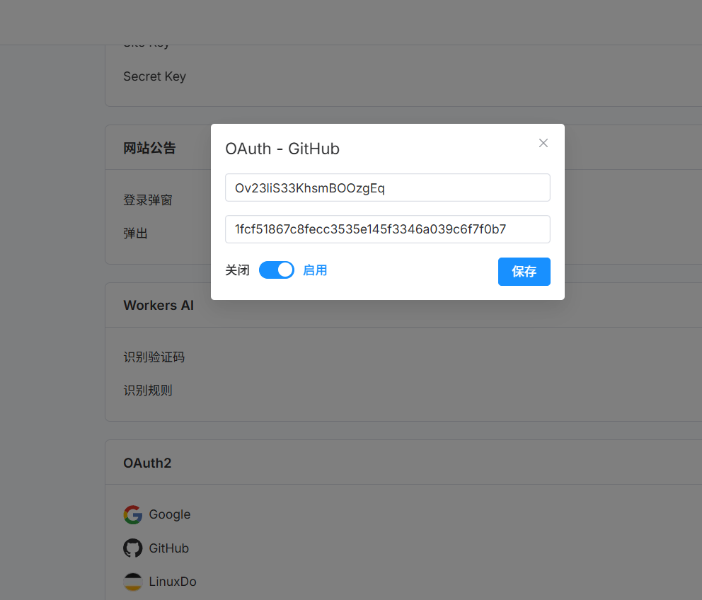

# OAuth2 Login

## Using GitHub

1. [Create an OAuth app on GitHub](https://github.com/settings/applications/new).

   - **Homepage URL**: `https://your-worker-custom-domain`
   - **Authorization callback URL**: `https://your-worker-custom-domain/login`

   Replace `your-worker-custom-domain` with your Worker's custom domain. Both
   fields must include the `https://` scheme and match the domain you actually
   visit, otherwise GitHub fails the authorization with `redirect_uri_mismatch`.

   

2. Copy the **Client ID** and **Client Secret** (the secret is shown only once).

3. Open **System Settings → OAuth2**, fill in the Client ID / Client Secret, then save.

   
