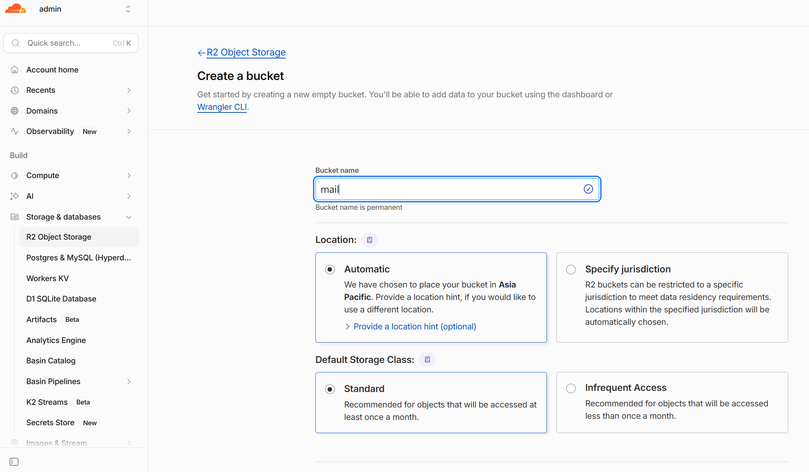
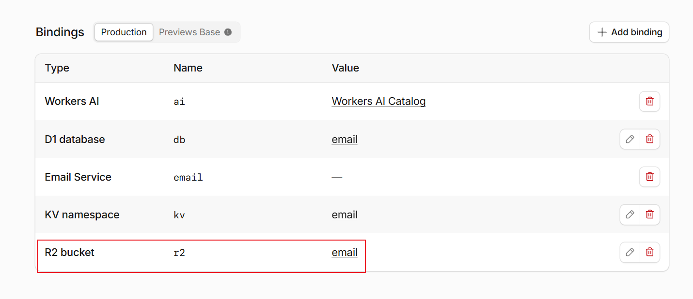

# Object Storage

:::warning
Email attachments are stored in KV by default. You can switch to R2 or another S3-compatible storage.
:::

1. Create an R2 bucket.

3. Add it to an Action Secret or a Workers binding.

   | Worker Binding Name | Action Secret  | Required | Description    |
   |---------------------|----------------|:--------:|----------------|
   | r2                  | R2_BUCKET_NAME |    ✅    | R2 bucket name |

   
