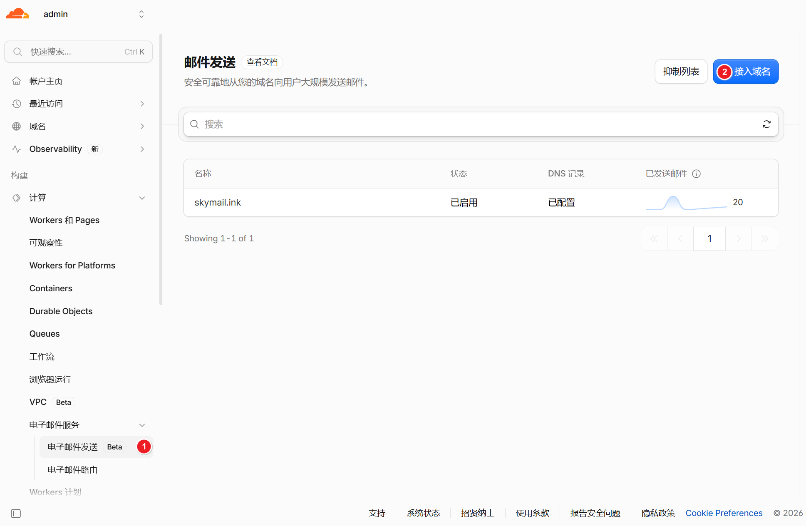
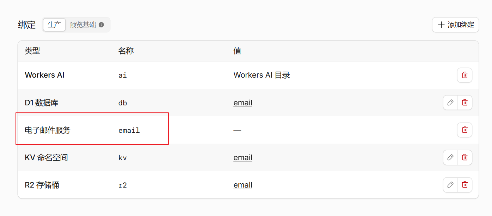

# Cloudflare 邮件发送
:::warning
该方式发送邮件需要 Workers Paid
:::

1. 添加发送邮件的域名
   

2. 绑定电子邮件服务到 Action Secret 或 Workers 绑定，变量值固定为 `email` 
    
   | Worker 绑定名称 | Action Secret | 必需 | 用途          |
   |-------------|---------------| :--: |-------------|
   | email       | EMAIL         |  ✅  | 固定填 `email` |    

   