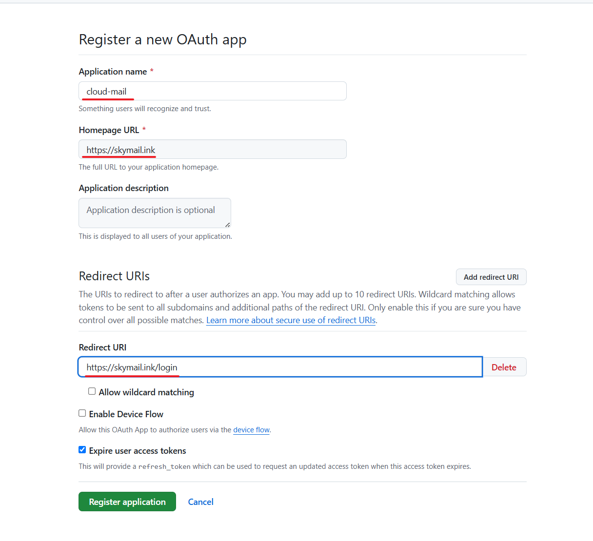
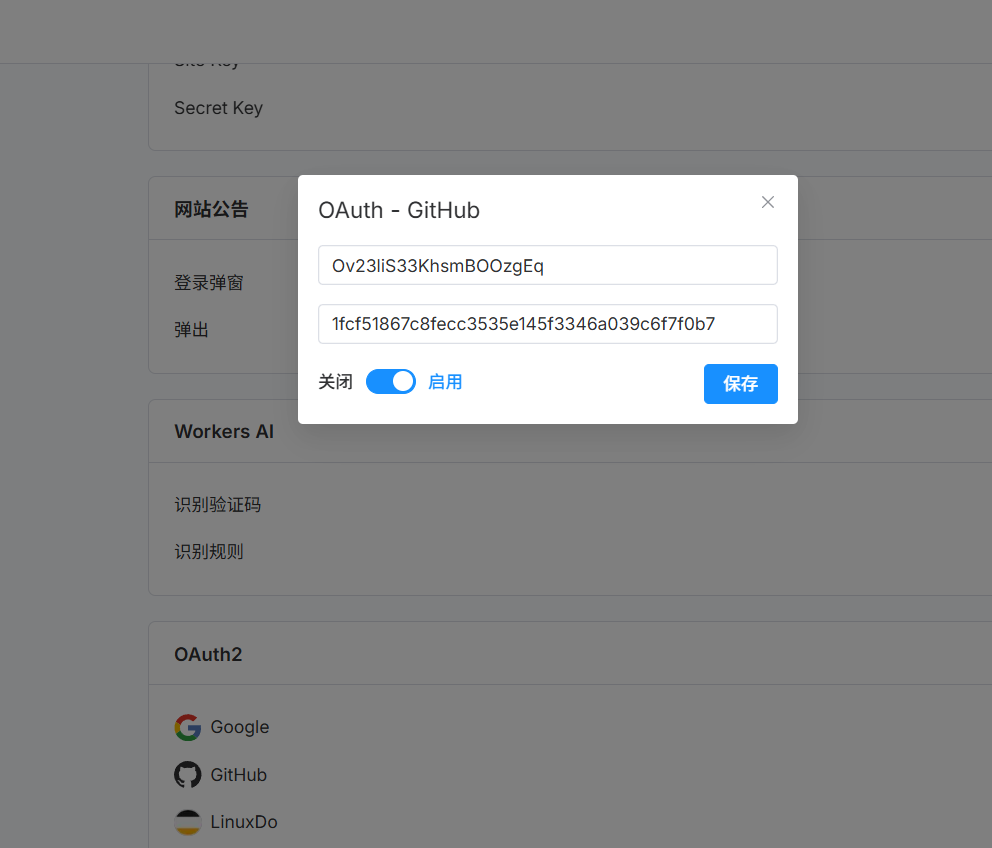

# OAuth2 登录

## 以 GitHub 为例

1. 在 https://github.com/settings/applications/new 创建 OAuth app。

   - **Homepage URL** 填 `https://你的worker自定义域名`
   - **Authorization callback URL** 填 `https://你的worker自定义域名/login`

   两处都要带 `https://` 协议头，且域名必须与实际访问的域名完全一致，
   否则 GitHub 授权后会直接报 `redirect_uri_mismatch`。

   

2. 创建后记下 **Client ID** 和 **Client Secret**（Secret 只在创建时显示一次）。

3. 在「系统设置 → Oauth2」里填入 Client ID / Client Secret 并保存。

   
